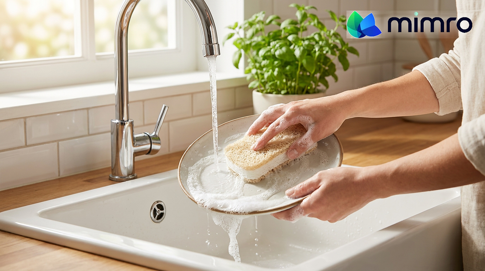

**Status:** Draft (unpublished) on Shopify · Shopify Admin → Online Store → Blog posts (Article ID 676055515374)
**Title:** After the Last Use: Knowing What to Do with Everyday Products
**Handle:** /blogs/news/after-the-last-use
**Tags:** #SustainableLiving, #LowWasteLiving, #EcoSwaps, #ConsciousConsumer, #DailyEssentials

---
Most of us try to do the “right thing” after we’re done with something. We rinse the container. We save the box. We stare at the recycling bin and hesitate. Is this recyclable or trash? Does it need to be clean? Is it compostable, or only in certain places?
That uncertainty is exhausting, and it’s one reason sustainable living can feel harder than it needs to be. When end-of-life rules are unclear, we either guess, or we give up and throw it away. Not because we don’t care, but because the instructions are inconsistent and the systems around us vary.
The truth is, disposal isn’t one universal rule. It depends on the material, your local waste services, and how a product is made. Mimro exists to make eco-conscious choices feel realistic and repeatable, and that includes what happens after the last use, not just what you buy.
## The habit: the End-of-Life Ladder
If you want a simple way to handle disposal without overthinking it, use an End-of-Life Ladder. Start at the top and move down only if you need to.
1. **Reuse (best default).** Before you toss something, ask: can it do one more job? A jar becomes storage. A pouch becomes a travel kit. A cloth becomes a cleaning rag. Reuse buys time and reduces demand for new stuff.
2. **Repair (if it’s meant to last).** If something is designed for repeat use, treat it like a tool, not a disposable. Tighten it, patch it, replace a part if you can. Repair keeps your low-waste choices from turning into low-waste purchases that still end up in the bin.
3. **Recycle (only if your local system accepts it).** Recycling isn’t a magic fix. It’s a local service with specific rules. Some places accept certain plastics, some don’t. Some require labels removed, and many require items to be clean and dry. If you’re unsure, check your local waste guidelines. “Recyclable” on a label doesn’t mean recyclable where you live.
4. **Compost (only if the conditions match).** Compostable items often need specific conditions. Some are home-compostable, some only industrial-compostable. If your area doesn’t have industrial composting, “compostable” may not be practical. Look for clear instructions and certifications, and match them to what you can actually access.
5. **Trash (sometimes the most honest option).** It sounds harsh, but it’s real: putting the wrong item in recycling can contaminate a whole batch. If you can’t verify it’s accepted, trash may be better than wish-cycling. The long-term goal is to land here less often by choosing repeat-use and refill-friendly options first.
Try it for one week: every time you finish a product, run it through the ladder. You’ll start noticing which materials and formats cause the most confusion, and that’s your clue for what to upgrade next.
## Choose products that make “after” easier
One of the easiest ways to reduce disposal stress is to buy fewer things that need complicated end-of-life decisions.
- **Sustainable cleaning essentials:** reusable tools that replace paper towels and disposable wipes, like the [Mimro Swedish Dishcloth](https://www.mimro.com/products/mimro-swedish-dishcloth) or the plant-based [Mimro Natural Loofah Cellulose Sponge](https://www.mimro.com/products/mimro-natural-loofah-cellulose-sponge). Less trash, and fewer “can I recycle this?” moments.
- **Low-waste home essentials:** practical items that support refill-first routines and cut constant packaging waste.
- **Natural personal care:** simpler routines and lower-packaging options that reduce bathroom-bin overflow.
- **Eco-friendly daily swaps:** repeat-use upgrades that shrink the volume of single-use items you have to deal with in the first place.
- **Food and drink basics:** reusables that cut snack and drink packaging, one of the biggest sources of daily waste.
**[Shop Cleaning Essentials →](https://www.mimro.com/collections/home-cleaners)**
**[Shop Kitchen Solutions →](https://www.mimro.com/collections/kitchen-solutions)**
**[Shop Personal Care →](https://www.mimro.com/collections/hygiene-essentials)**
The goal isn’t perfection. It’s choosing categories that make your end-of-life decisions simpler and more consistent.
## Build better defaults, not more disposal
The easiest way to make “after the last use” simpler is to create fewer last uses. Pick one repeat-use item you’ll reach for every week, and let that one default replace dozens of disposable decisions over time.
**[Shop Top Picks →](https://www.mimro.com/collections/eco-pick)**
**[Explore All Collections →](https://www.mimro.com/collections/all)**
## Mimro AI: help choosing what fits your routine
Not sure what to buy first, what will actually last, or what makes the biggest difference? Tell Mimro AI, our eco-shopping assistant, what you’re trying to reduce (packaging, disposables, confusing materials), what your routine looks like, and your comfort level. It helps you narrow down options from Mimro’s collections without guilt or information overload.
## Sustainable living doesn’t end at checkout
When you know what to do with what you already have, you waste less, stress less, and make smarter choices next time.
**Use the End-of-Life Ladder, follow your local disposal rules, and build repeat-use defaults that make everyday living, and everyday disposal, feel simpler.**
