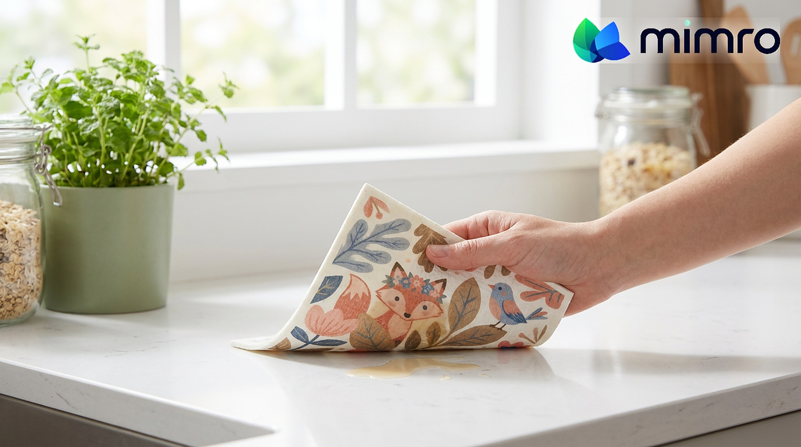

**Status:** Draft (unpublished) on Shopify · Shopify Admin → Online Store → Blog posts (Article ID 676055744750)
**Title:** The Things We Don’t Think About: Everyday Waste That Happens on Autopilot
**Handle:** /blogs/news/the-things-we-dont-think-about
**Tags:** #SustainableLiving, #LowWasteLiving, #EcoSwaps, #ConsciousConsumer, #DailyEssentials

---
Waste doesn’t always look like an overflowing bin. Sometimes it looks like running the tap a little longer than necessary, buying another bottle of cleaner before finishing the last one, forgetting leftovers at the back of the fridge, or ordering something online without a thought for its packaging.
These habits seem too small to matter. But when they become part of our daily routines, they quietly add up.
The problem isn’t that we don’t care about the environment. It’s that many everyday decisions happen without much thought. We repeat what feels convenient, familiar, or automatic, and rarely stop to consider what those choices leave behind.
The good news? You don’t need to change your entire lifestyle to make a difference. You just need to start noticing what happens on autopilot.
## Notice the habits hiding in plain sight
- **The products we overuse.** A little extra laundry detergent, too much dish soap, or more cleaning spray than needed means products run out faster than expected. Following usage instructions and measuring carefully helps supplies last longer.
- **The food we forget.** Leftovers pushed behind newer groceries, vegetables forgotten in a drawer, and ingredients bought without a meal in mind can all end up wasted. A quick fridge check before shopping helps you use what you already have.
- **The things we replace too soon.** A worn cleaning cloth, a container with plenty of life left, or a product that just needs proper care may not need replacing yet. Check whether cleaning, repairing, or reusing it is a reasonable option first.
- **The packaging we barely notice.** Individual purchases, repeated deliveries, and extra outer packaging create waste beyond the item itself. Combining orders when practical and choosing products with less packaging can help.
- **The resources we leave running.** Water flowing while we brush our teeth, lights left on in empty rooms, and electronics running when they’re not needed are easy to overlook. Small reminders make mindful use feel natural.
None of these habits makes you careless. They simply show how easily convenience becomes automatic.
## The habit: a one-week Autopilot Check
The first step isn’t buying something new. It’s paying attention. For one week, notice what you throw away, use up quickly, or keep replacing. No complicated tracking system needed. Just ask yourself:
1. **What am I wasting?**
2. **Why does it keep happening?**
3. **What small change would prevent it next time?**
Then attach that change to a habit you already have. Check the fridge before writing your grocery list. Measure cleaning products before using them. Keep reusable items where you can easily reach them. Finish opened products before starting new ones.
These small adjustments work because they address why waste happens in the first place: repetition without reflection.
## Choose products that support better habits
Once you know where waste happens, the right products make better choices easier to keep.
- **In the kitchen:** the [Mimro Swedish Dishcloth](https://www.mimro.com/products/mimro-swedish-dishcloth) is a reusable option for wiping surfaces, handling spills, and cleaning dishes. It’s washable and dries fast, so it’s practical for repeated use.
- **For cleaning:** the [Mimro Natural Loofah Cellulose Sponge](https://www.mimro.com/products/mimro-natural-loofah-cellulose-sponge) is a plant-based alternative for everyday dishwashing and surface cleaning. Pair good tools with careful product measuring to avoid unnecessary consumption.
- **In personal care:** shampoo bars, conditioner bars, and toothpaste tablets offer alternatives to some conventional bottled formats, and Mimro’s refill options help you reduce packaging where it suits you.
The goal isn’t to replace everything you own. Use what you have first, then choose a better alternative when something genuinely needs replacing.
**[Shop Kitchen Solutions →](https://www.mimro.com/collections/kitchen-solutions)**
**[Shop Cleaning Essentials →](https://www.mimro.com/collections/home-cleaners)**
**[Shop Personal Care →](https://www.mimro.com/collections/hygiene-essentials)**
## Shop with your habits in mind
Before adding anything to your cart, think about the problem you want to solve. Throwing away cleaning materials constantly? Forgetting food? Buying the same essentials too often? Start with that need.
**[Shop Top Picks →](https://www.mimro.com/collections/eco-pick)**
**[Explore All Collections →](https://www.mimro.com/collections/all)**
## Let Mimro AI help you choose thoughtfully
Not sure which options suit your needs? Instead of shopping for whatever looks sustainable, start with a specific question for Mimro AI, our eco-shopping assistant: What could help me reduce packaging? Which reusable option suits my kitchen? What fits my current routine? A focused search helps you choose well without turning sustainability into more clutter or spending.
## Small things count when we start noticing
Everyday waste often begins with something we barely notice. But once you recognize a pattern, you can change it. You don’t need a perfect routine or a waste-free home, just a few better decisions that become habits over time.
**Use what you have. Pay attention to what you consume. Make things last, and replace them thoughtfully when the time comes.**
