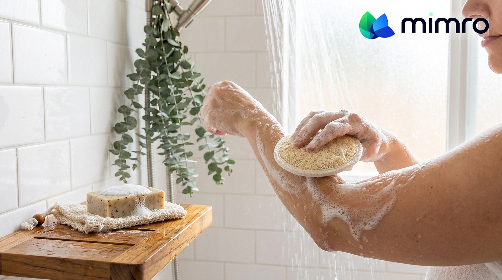

**Status:** Draft (unpublished) on Shopify · Shopify Admin → Online Store → Blog posts (Article ID 676055777518)
**Title:** Sustainable by Season: How Your Everyday Habits Change Throughout the Year
**Handle:** /blogs/news/sustainable-by-season
**Tags:** #SustainableLiving, #LowWasteLiving, #EcoSwaps, #ConsciousConsumer, #DailyEssentials

---
Sustainable living often gets framed like a personality trait. Either you “are” low-waste, or you’re not. But real life doesn’t work like that. Your routines change constantly, and your habits change with them.
In summer, you’re out more. You buy more drinks on the go and need hydration, sunscreen, quick cleanups, and travel-friendly basics. In the school season, mornings speed up and convenience wins. In winter, laundry piles up, indoor messes increase, and you restock home and personal care more often. Add holidays, hosting, and weekend trips, and your “simple” routine becomes a rotating set of needs.
That’s why many eco habits don’t stick. It’s not that you failed. It’s that your system didn’t adapt. If your low-waste options only work for one version of your life, you’ll fall back into single-use shortcuts the moment the season changes.
Mimro exists to make low-waste living feel normal and repeatable, even when your routine shifts. The goal isn’t to do everything all year. It’s to build seasonal defaults you can reuse.
## The habit: the Seasonal Reset
Instead of trying to be perfectly sustainable, do one seasonal reset, one routine at a time. At the start of each season, ask:
1. **What routine is about to change?** Hydration, laundry, travel, hosting, school mornings.
2. **What disposable shortcut shows up when I’m busy?** Paper towels, wipes, bottled drinks, snack packaging, “emergency” buys.
3. **What reusable or refill-friendly default can replace it?**
4. **Where will I keep it so I actually use it?** This is the difference between a good intention and a habit. The better option has to be the closest option.
Keep it simple: choose one seasonal routine to upgrade for the next 30 days. Not your whole life. Just one repeat moment.
## Match your swaps to the season you’re in
Once you know the routine you’re upgrading, shopping gets easier. You’re not buying random eco stuff. You’re building a seasonal kit that supports your real habits.
- **Food and drink basics:** for summer hydration, school lunches, road trips, and busy days when packaging adds up fast.
- **Sustainable cleaning essentials:** quick, reusable tools for seasonal messes, from summer spills to winter indoor cleanup, like the [Mimro Swedish Dishcloth](https://www.mimro.com/products/mimro-swedish-dishcloth) and [Mimro Coconut Cellulose Kitchen Sponge](https://www.mimro.com/products/mimro-coconut-cellulose-kitchen-sponge), without burning through paper towels.
- **Low-waste home essentials:** practical items that reduce restocking and keep routines smooth when schedules get hectic.
- **Natural personal care:** for seasonal self-care, travel, and basics that run out faster than you expect, like the [Mimro Natural Loofah Bath Set](https://www.mimro.com/products/mimro-natural-loofah-bath-set).
- **Eco-friendly daily swaps:** small upgrades that cut single-use habits across the year, one routine at a time.
**[Shop Kitchen Solutions →](https://www.mimro.com/collections/kitchen-solutions)**
**[Shop Cleaning Essentials →](https://www.mimro.com/collections/home-cleaners)**
**[Shop Self-Care →](https://www.mimro.com/collections/self-care-goods)**
The goal isn’t to switch everything each season. It’s to choose the category that removes the most friction in your current routine.
## Start with one seasonal default
The simplest path: pick one item you’ll use weekly (or daily) in the season you’re entering, and build one seasonal default kit, a small set of reusables that stays ready so you don’t have to re-decide every time your routine shifts.
**[Shop Top Picks →](https://www.mimro.com/collections/eco-pick)**
**[Explore All Collections →](https://www.mimro.com/collections/all)**
## Mimro AI: a smarter way to shop for your season
Not sure what fits your current season? Tell Mimro AI, our eco-shopping assistant, what’s changing (school mornings, travel, hosting, laundry, on-the-go days), what you want to avoid (single-use plastics, clutter, complicated care), and your comfort level. It helps you narrow down options from Mimro’s collections so your seasonal routine is easy to repeat.
## A system that adapts
Sustainable living isn’t one routine. It’s a set of routines that change throughout the year. You don’t need to be perfect in every season. You just need a system that adapts.
**Start with one Seasonal Reset, upgrade one repeat habit, and keep the better option where you naturally reach.**
