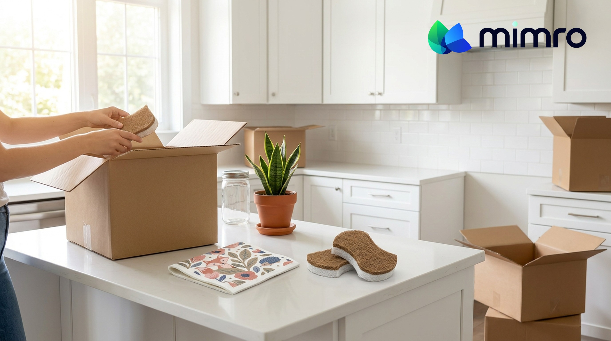

**Status:** Published Nov 9, 2026 · Shopify Admin → Online Store → Blog posts (Article ID 676055810286)
**Title:** New Chapter, Lighter Footprint: Making More Thoughtful Choices During Life Changes
**Handle:** /blogs/news/new-chapter-lighter-footprint
**Tags:** #SustainableLiving, #LowWasteLiving, #EcoSwaps, #ConsciousConsumer, #DailyEssentials

---
Every new chapter brings a to-do list. A new home needs setting up, university calls for supplies, a new job changes your routine, and welcoming a baby brings new responsibilities. Suddenly, shopping feels like the easiest way to get ready.
Between endless checklists, recommendations, and perfectly organized spaces on social media, preparation can turn into pressure. You start wondering whether you need new furniture, clothes, matching containers, cleaning supplies, and products you’ve never used before.
But a fresh start doesn’t require a completely new set of belongings. It’s a chance to decide what you genuinely need, what you already have, and which habits you want to carry into your next chapter.
## The fresh-start trap: when preparing means buying more
Life transitions can make familiar belongings feel outdated. A new apartment may inspire an entirely new kitchen setup. Starting university can make it feel like everyone else has better supplies. Becoming a parent brings endless recommendations for products that promise to make life easier.
The result? Unnecessary spending, clutter, and waste before your new routine has even settled. Usable items get discarded because they don’t match a new space, while unopened purchases sit in cupboards waiting for a purpose.
Before adding anything to your cart, ask: *Am I buying this because I need it, or because I feel a new beginning should look different?*
## The habit: build better habits before a shopping list
1. **Take inventory before shopping.** Kitchen towels, storage containers, toiletries, cleaning tools, and everyday bags may still be perfectly useful. Reorganize or reuse them before deciding they need replacing.
2. **Separate essentials from nice-to-haves.** Make two lists: what you need now and what can wait. A student may prioritize basic cleaning supplies and a reusable water bottle over decor. A new parent may focus on practical essentials over every recommended baby product.
3. **Let your routine reveal your needs.** You don’t have to anticipate every challenge in advance. Spend a few weeks in your new space or schedule, then notice what you use, what creates waste, and where a better alternative would genuinely help.
4. **Choose items that do more.** Prioritize durable, reusable, refillable, or versatile products. A washable cloth can replace disposable alternatives, and refillable cleaning products let you reuse containers.
5. **Give unwanted items another life.** Sell, donate, share, or responsibly recycle usable belongings instead of throwing them away. A new chapter for you doesn’t have to mean the end of an item’s useful life.
## Shop thoughtfully: essentials for your next chapter
- **Kitchen and household essentials:** the [Mimro Swedish Dishcloth](https://www.mimro.com/products/mimro-swedish-dishcloth) is a washable, fast-drying alternative to paper towels, and the [Mimro Natural Loofah Cellulose Sponge](https://www.mimro.com/products/mimro-natural-loofah-cellulose-sponge) is a plant-based option for dishwashing.
- **Home cleaning:** refillable formats and practical tools that suit your space and reduce dependence on disposable supplies. Choose what fits your existing habits rather than replacing everything at once.
- **Personal care and hygiene:** shampoo bars, toothpaste tablets, and reusable personal-care essentials simplify bathroom routines, whether you’re moving into shared accommodation or starting a new job.
- **Reusable everyday essentials:** food wraps, shopping bags, and reusable containers for university, work, or home. The best choice is the one you’ll remember to use.
**[Shop Kitchen Solutions →](https://www.mimro.com/collections/kitchen-solutions)**
**[Shop Cleaning Essentials →](https://www.mimro.com/collections/home-cleaners)**
**[Shop Personal Care →](https://www.mimro.com/collections/hygiene-essentials)**
## Ready for your next chapter? Shop with purpose
Your shopping list should reflect your needs, not someone else’s idea of the perfect fresh start. Start with one category, identify what genuinely needs replacing, and choose products that fit your budget, space, and routine. A few well-chosen swaps beat a complete lifestyle overhaul.
**[Shop Top Picks →](https://www.mimro.com/collections/eco-pick)**
**[Explore All Collections →](https://www.mimro.com/collections/all)**
## Not sure what you need? Ask Mimro AI
Sometimes the hardest part is knowing where to begin. Whether you’re cutting plastic in a new apartment, building a university essentials list, or simplifying a new household routine, describe your situation to Mimro AI, our eco-shopping assistant: what you already own and the problem you want to solve. It helps you narrow your choices instead of growing an already overwhelming list.
## A new beginning doesn’t need more stuff
Moving, studying, starting a family, or beginning a new job already brings enough change. You don’t need to replace everything to make your next chapter meaningful.
**Use what you have. Buy what you need. Choose better alternatives when something genuinely needs replacing, and start your next chapter with less clutter and a lighter footprint.**
