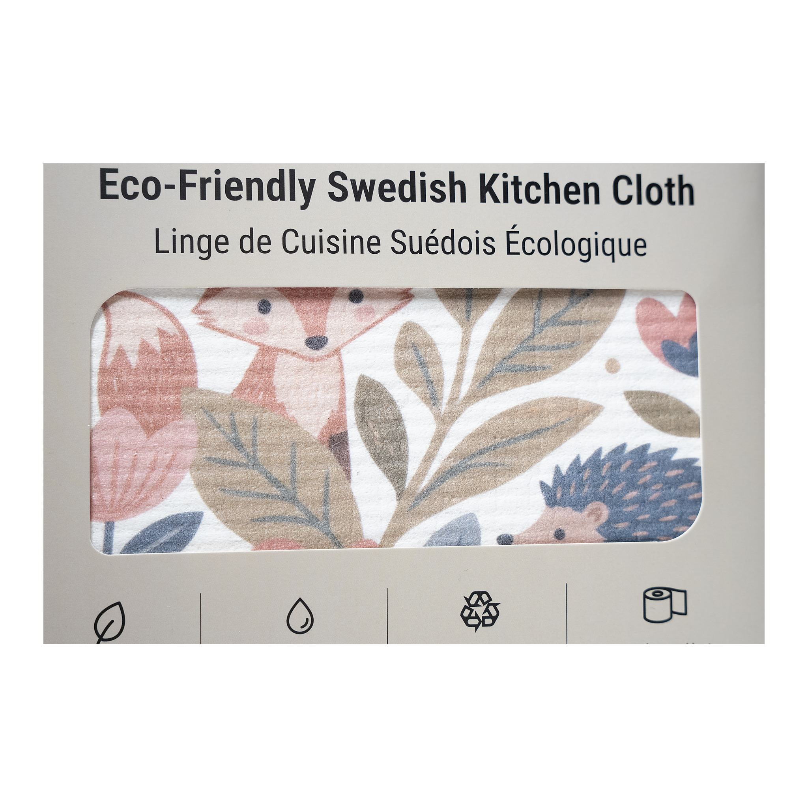

**Status:** Draft (unpublished) on Shopify · Shopify Admin → Online Store → Blog posts (Article ID 676055843054)
**Title:** The Sustainable Workday: Small Environmental Choices Beyond Your Front Door
**Handle:** /blogs/news/the-sustainable-workday
**Tags:** #SustainableLiving, #LowWasteLiving, #EcoSwaps, #ConsciousConsumer, #DailyEssentials

---
Between morning commutes, back-to-back meetings, lunch breaks, and the rush to finish the day, sustainability can slip down the priority list. Coffee comes in a disposable cup, lunch arrives in layers of packaging, and forgotten chargers or printed documents become part of the daily routine.
Whether you work from an office, a coworking space, or your kitchen table, your workday involves choices that affect how much you consume and throw away.
The challenge isn’t finding time for an entirely new lifestyle. It’s recognizing where small adjustments fit into the workday you already have.
## The habit: rethink what follows you to work
- **Rethink your commute.** When practical, walk, cycle, take public transit, or share a ride. If you can work remotely, combining errands or coordinating office days also cuts unnecessary trips. The best choice depends on your location, schedule, accessibility, and safety.
- **Make lunch less wasteful.** Buying lunch every day means repeated takeaway containers, cutlery, napkins, and packaging. Prep meals when convenient, carry a reusable container, or keep cutlery at your desk. If you order food, request only the extras you actually need.
- **Make meetings more intentional.** Before printing an agenda or handouts, consider whether digital will work. For in-person meetings, reusable cups and shared supplies reduce disposables.
- **Treat shared resources with care.** Lights, air conditioning, printers, and equipment are easy to overlook because everyone uses them. Switch off what you’re responsible for when it’s safe and appropriate, avoid unnecessary printing, and follow your workplace’s policies.
- **Build a better end-of-day habit.** Before logging off, check that your lunch container is ready for tomorrow, devices are charging appropriately, and unneeded equipment is switched off. A two-minute check makes tomorrow easier.
None of this requires perfection. It simply makes thoughtful choices easier to repeat.
## Choose essentials that work beyond home
Start with what you already use regularly rather than buying a new collection of products.
- **Lunch and hydration:** reusable food containers, snack bags, and water bottles reduce dependence on disposable packaging. Explore Mimro’s Kitchen Solutions collection for food-storage and on-the-go options.
- **Reusable cleaning tools:** a cloth in your work bag or home office handles everyday spills and surfaces. The [Mimro Swedish Dishcloth](https://www.mimro.com/products/mimro-swedish-dishcloth) is made from 70% cellulose wood pulp and 30% cotton, is machine washable, dries fast, and is designed for 100+ washes.
- **Personal care on the go:** long workdays and commutes make portable formats useful. Shampoo and conditioner bars and toothpaste and mouthwash tablets offer alternatives to some bottled formats. Choose what suits your routine, storage, and travel needs.
The goal isn’t to carry every sustainable product to work. It’s to keep a few useful essentials within reach so better choices are practical, not inconvenient.
**[Shop Kitchen Solutions →](https://www.mimro.com/collections/kitchen-solutions)**
**[Shop Cleaning Essentials →](https://www.mimro.com/collections/home-cleaners)**
**[Shop Personal Care →](https://www.mimro.com/collections/hygiene-essentials)**
## Shop for the workday you actually have
Your needs depend on how you work. An office commuter may benefit most from reusable lunch containers, while someone working from home might prioritize washable cloths or kitchen essentials. Start by identifying one recurring source of waste, then find the product that fits that specific need.
**[Shop Top Picks →](https://www.mimro.com/collections/eco-pick)**
**[Explore All Collections →](https://www.mimro.com/collections/all)**
## Let Mimro AI help you find the right fit
Not sure what makes sense for your working routine? Ask Mimro AI, our eco-shopping assistant, a simple question: What reusable essentials would make my commute easier? How can I cut lunch packaging? What fits my home-office routine? Starting with a real need helps you avoid products that end up unused in a drawer.
## Take better habits beyond the clock
Sustainable living doesn’t stop at your front door, and it doesn’t need to interrupt your productivity. It can start with the container you bring to lunch, the journey you choose when practical, or the equipment you switch off.
**Choose one change this week. Make it easy to repeat, then build from there. Small decisions matter when they’re part of how you work every day.**
